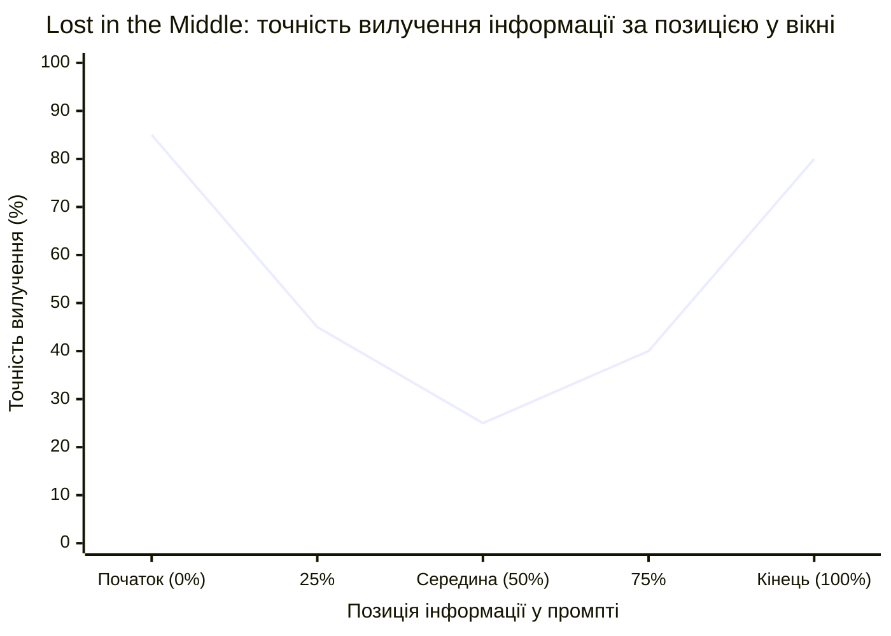
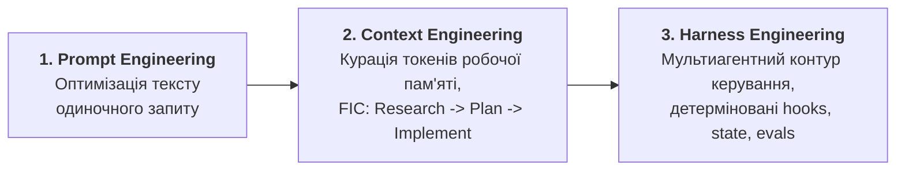

# Інженерія програмних проєктів з участю ШІ-агентів (AI SDLC): межі застосовності, парадокси керування та нові системні вузькі місця

> 🇺🇦 Українська версія

> Матеріали наукової доповіді з управління ІТ-проєктами та програмної інженерії  
> Пов'язана доповідь із математичної формалізації: [Управління стохастичними ШІ-агентами (18)](./18_ai_agent_control_seminar.md)  
> Наступне дослідження циклу: [Архітектура довіреного контексту в AI SDLC (`ai_sdlc/`)](./ai_sdlc/index.md)

---

## 1. Вступ: Ілюзія швидкості та зміщення вузького місця в AI SDLC

Шановні колеги!

Останні два роки індустрія програмної інженерії та управління ІТ-проєктами живе в очікуванні кратного прискорення розробки завдяки генеративному штучному інтелекту та автономним кодинг-агентам. Управлінська гіпотеза звучить привабливо: якщо модель генерує код у десятки разів швидше за людину, то строки доставки продуктів мають пропорційно скоротитися.

Однак емпіричні дані з реальних промислових проектів та досліджень програми **DORA (DevOps Research and Assessment - підрозділ Google Cloud)**[^dora2024] фіксують системний парадокс. Хоча на рівні окремого фахівця будь-якої ролі в команді (розробника, QA, аналітика чи ліда) генеративний ШІ виступає дієвим каталізатором продуктивності (*productivity enabler* - прискорює драфтинг артефактів, рутинний аналіз та підтримує стан потоку), на рівні наскрізного процесу доставки наївне впровадження дає зворотний ефект. Коли команди масштабують використання моделей без перебудови процесів життєвого циклу (SDLC), вони стикаються з п'ятьма системними симптомами:
1. Модель виходить за межі поставленої задачі, непомітно вносячи регресії в суміжні частини системи та порушуючи чинні контракти.
2. Стрімко зростає обсяг технічного боргу та порушуються базові принципи проектування.
3. Репозиторії наповнюються тим, що в інженерному середовищі отримало назву *«AI Slop»* - багатослівним, структурно неохайним кодом, який формально компілюється, але ускладнює підтримку.
4. Підхід, який працював на демо-прикладах і малих скриптах, перестає працювати на великих та архітектурно складних репозиторіях.
5. **Парадокс розміру партії змін (*Batch Size Paradox*):** за даними DORA, прискорення генерації коду без зміни контуру верифікації призводить до роздування розміру Pull Request-ів. Як наслідок, на кожні 25% зростання наївного впровадження ШІ стабільність релізів падає на 7.2%, а етап верифікації та рев'ю перетворюється на головне вузьке місце проєкту (класичне обмеження за теорією Голдратта).

**Головна теза моєї доповіді:**  
Впровадження ШІ у розробку ПЗ не усуває класичні проблеми управління проєктами, а переносить вузьке місце з фази **написання коду** на фазу **управління контекстом, архітектурної декомпозиції та верифікації рішень** (див. [математичний базис керування](./18_ai_agent_control_seminar.md) та практичний розбір у статті [«Архітектура довіреного контексту в AI SDLC»](./ai_sdlc/01_context_architecture_brief.md)). ШІ діє як нелінійний підсилювач: він прискорює інженерно зрілі команди і водночас масштабує хаос там, де процеси та архітектура не формалізовані.

Сьогодні я хочу розглянути три питання на основі практичного інженерного досвіду промислової розробки високонавантажених ІТ-систем із використанням агентних контурів:
- як еволюціонували підходи від простого промптингу до інженерії контексту (*Context Engineering*) та інженерії контурів керування (*Harness Engineering*);
- **де саме ШІ працює вдало, а де зазнає системного краху** - і чому це напряму залежить від класичної архітектури ПЗ;
- які **несподівані парадокси та відкриті науково-практичні проблеми** виникають перед керівниками проєктів та архітекторами.

---

## 2. Становлення понятійного апарату та еволюція підходів: Prompt → Context → Harness Engineering

Перш ніж аналізувати інженерні рішення, необхідно зробити важливе **методологічне зауваження щодо термінології**. Галузь агентної розробки ПЗ розвивається настільки стрімко, що її понятійний апарат ще не встиг увійти до канонічних стандартів програмної інженерії на кшталт SWEBOK або ISO/IEC/IEEE 12207. Більшість термінів, якими сьогодні оперують R&D-команди, виникли у 2024-2026 роках у дослідницьких лабораторіях (Anthropic, Stanford, NVIDIA, Thoughtworks, HumanLayer).

Базовою атомарною одиницею у цьому просторі є **токен (*token*)** - субслівний фрагмент тексту або коду (в середньому 3-4 символи чи ~0.75 слова; у коді це окремі оператори, пробіли/відступи або частини ідентифікаторів). Модель архітектурно не оперує поняттями «файл», «функція» чи «клас» - вона сприймає світ виключно як послідовність дискретних токенів, перетворених на вектори.

Тому виклад побудовано за причинно-наслідковим ланцюжком: від квантування інформації в токенах та фізичних обмежень моделі до зовнішніх контурів керування (з фіксацією першоджерел термінології).

### 2.1. База: Stateless-природа моделей та феномен «Dumb Zone» (*Lost in the Middle*)
Велика мовна модель (LLM) під час обробки запиту не зберігає внутрішній стан між викликами (*stateless*), хоча інтерфейс чату створює оманливе враження безперервного діалогу. Її коректніше розглядати як чисту математичну функцію:
`Tokens In → LLM → Tokens Out`
З кожним новим повідомленням у чаті на вхід цієї функції повторно подається **весь накопичений масив токенів** у межах її робочої пам'яті (*context window*): системний промпт середовища, схеми підключених інструментів (MCP-серверів), інструкції скілів та агентів, уся попередня історія діалогу, а також сирі результати пошуку по файлах чи логах.

Прямим наслідком цієї *stateless*-архітектури є явище, яке в інженерній практиці (зокрема у працях Декса Хорті з проєкту HumanLayer, [*Advanced Context Engineering for Coding Agents*, 2025](https://github.com/humanlayer/humanlayer)[^horthy2025]) отримало сленгову назву **«Dumb Zone» (зона отупіння моделі)**.  
В академічній науці цей ефект має строге експериментальне та математичне обґрунтування:
1. **Ефект *Lost in the Middle*** (Liu et al., Стенфорд / UC Berkeley, 2024)[^liu2024]: модель надійно витягує дані на початку та в кінці промпту, але втрачає інформацію в його середині (графік точності утворює U-подібний провал).

2. **Розрив між номінальним та ефективним контекстом (*Effective Context Size*)**, доведений дослідниками NVIDIA у бенчмарку *RULER* ([Hsieh et al., *COLM* 2024](https://arxiv.org/abs/2404.06654))[^hsieh2024]: попри маркетингові заяви про вікно у 200 тисяч або 1 мільйон токенів, реальна зона, де модель утримує високу якість багатоходового логічного виведення, становить лише **40-60% від максимального розміру вікна**.

Практичні вимірювання в інженерних ІТ-командах повністю підтверджують цей поріг у 40-60%. Коли розробник веде один нескінченний чат - спочатку просить спроектувати сервіс, потім шукає файли, потім скидає туди логи падіння тестів і просить виправити баг, - контекст забруднюється (*context pollution*). Модель входить у *Dumb Zone*: забуває початкові архітектурні обмеження і починає генерувати хаотичні здогадки.

Перше інтуїтивне рішення інженера - правило «одна задача = один новий чат» для скидання історії. Проте ізольований чат створює зворотну проблему: модель починає з чистого аркуша і втрачає контекст проєкту, змушуючи людину щоразу вручну копіювати вхідні вимоги, архітектурні обмеження та схеми коду. Необхідність подолати цю дилему (очищати вікно від шуму, але системно зберігати та передавати суттєвий стан) і привела індустрію до переходу від інтуїтивного промптингу до **інженерії контексту (*Context Engineering*)**.

### 2.2. Еволюція контурів керування: Prompt → Context → Harness Engineering

Необхідність боротися із забрудненням контекстного вікна породила три послідовні стадії зрілості інструментарію AI SDLC:

1. **Prompt Engineering (інженерія запитів)** - історично перший етап, сфокусований на підборі формулювань одиночного текстового промпту. Працює виключно на малих ізольованих задачах.
2. **Context Engineering (інженерія контексту)** - перша системна відповідь на проблему *Dumb Zone*. Термін ввели в широкий обіг у середині 2025 року Андрей Карпати ([Karpathy, 2025](https://x.com/karpathy/status/1937902205765607626)), Тобі Лютке ([Lütke, 2025](https://x.com/tobi/status/1935533422589399127)) та дослідницька група Anthropic ([*Effective context engineering for AI agents*, 2025](https://www.anthropic.com/engineering/effective-context-engineering-for-ai-agents))[^anthropic_ce2025]. На відміну від промпт-інженерії, інженерія контексту - це дисципліна динамічного формування, фільтрації та очищення всієї робочої пам'яті моделі на кожному кроці обчислень (документи, інструменти, пам'ять, результати виконання).  
   Ключовий метод утримання моделі у «розумній зоні» (до 40-50% вікна) отримав назву **Frequent Intentional Compaction (FIC - часта цілеспрямована компактизація, термін D. Horthy / HumanLayer, 2025)**[^horthy2025]. Замість покладатися на автоматичну суммаризацію чату при переповненні вікна (яка часто втрачає критичні технічні деталі), процес примусово розбивається на три окремі сесії зі створенням проміжних структурованих артефактів:
   - **Фаза 1: Research (Дослідження)** - агент аналізує кодову базу, знаходить релевантні файли і стискає знання в об'єктивний Markdown-звіт. Вся пошукова історія (тисячі рядків сирого коду й викликів утиліт) знищується разом із закриттям сесії.
   - **Фаза 2: Plan (Планування)** - у чистій сесії на базі звіту формується лаконічний план імплементації з точними шляхами, сигнатурами та кроками тестування. Між фазами обов'язково працює контур перевірки людиною (*Human-in-the-Loop*). За своєю суттю це пряма паралель із **BDD (Behavior-Driven Development)**: замість сліпого написання коду спочатку фіксуються формалізовані сценарії поведінки, граничні умови та контракти тестування, верифіковані людиною.
   - **Фаза 3: Implement (Реалізація)** - нова сесія отримує лише затверджений план і генерує код суворо за специфікацією, залишаючись у «розумній зоні» контекстного вікна.

   Цей підхід сформував окремий проміжний клас рішень - **Scaffolded LLMs / Compound AI Systems** (термінологія M. Zaharia et al. / Berkeley, 2024 та *Agentic Workflows* за A. Ng). Це ще не моделі глибокого міркування (*Native Reasoning Models* класу o1 чи R1 із вбудованим прихованим ланцюжком думок), але вже й не наївний разовий промптинг: стандартну інструктивну модель багаторазово проганяють через зовнішні алгоритмічні цикли декомпозиції, планування та перехресної верифікації.
3. **Перехід до багатоходових систем - Workflows vs. Agents:** коли цей цикл автоматизується, виникають два класи архітектур за класифікацією дослідників Anthropic Еріка Шлунца та Баррі Чжана ([*Building effective agents*, 2024](https://www.anthropic.com/research/building-effective-agents))[^schluntz2024]:
   - **Workflow (робочий потік)** - система, де LLM та зовнішні інструменти оркеструються через заздалегідь визначені, детерміновані шляхи в коді;
   - **Agent (агент)** - система, в якій LLM динамічно скеровує власний процес міркування, самостійно обираючи інструменти, кількість ітерацій та делегування підзадач у дочірні ізольовані процеси (*Subagents*).
4. **Harness Engineering (інженерія агентної оснастки / контуру керування)** - логічний підсумок еволюції, що закріпився на рубежі 2025-2026 років у працях інженерів Anthropic ([*Effective harnesses for long-running agents*, 2025](https://www.anthropic.com/engineering/effective-harnesses-for-long-running-agents))[^anthropic_harness2025] та аналітиків Thoughtworks ([B. Böckeler / Martin Fowler, *Harness Engineering*, 2026](https://martinfowler.com/articles/exploring-gen-ai/harness-engineering.html))[^bockeler2026]. Слово *harness* буквально означає «упряж» або «випробувальний стенд / оснастка».  
   Якщо Context Engineering відповідає за те, *яку інформацію подати моделі*, то Harness Engineering - це проектування **зовнішньої детермінованої інфраструктури навколо недетермінованої LLM**:
   - оркестрація спеціалізованих агентів у конвеєрі життєвого циклу (наприклад, у промисловому контурі розробки: [*Architect Agent → Change Planner → Design Challenger → Solution Coupling Challenger*](./18_ai_agent_control_seminar.md));
   - детерміновані перехоплювачі (*hooks*), які на рівні середовища блокують заборонені операції (наприклад, рекурсивне видалення директорій або доступ за межі дозволеного контуру);
   - зовнішнє збереження стану (*state persistence* у локальних артефактах проекту: що сплановано, які звіти статичних аналізаторів отримано, що перевірено і що зафіксовано в Git), що перетворює stateless-модель на керований процес із точками збереження (*save points*) та контуром верифікації (*evals*).

---

## 3. Де ШІ працює вдало, а де зазнає краху: архітектура ПЗ як фактор AI-готовності

### 3.1. Зміна парадигми: від класичного SDLC до AI SDLC

Перш ніж оцінювати межі застосовності моделей, необхідно зафіксувати фундаментальне зрушення у самій моделі життєвого циклу розробки ПЗ:

| Вимір | Класичний SDLC | AI SDLC (контур з участю агентів) |
| :--- | :--- | :--- |
| **Головне вузьке місце** | Швидкість написання та ручного налагодження коду людиною | Пропускна здатність контуру верифікації та якість контексту |
| **Неявні знання (*Tribal Knowledge*)** | Допустимі: інженери тримають архітектуру в голові й узгоджують на мітингах | Неприпустимі: агент знає лише те, що явно подано у вікно токенів |
| **Роль коду** | Кінцевий продукт праці програміста | Проміжний артефакт, вартість генерації якого прямує до нуля |
| **Базовий цикл фаз** | Вимоги → Архітектура → Кодування → Тестування → Реліз | Намір → Курація контексту → Синтез → Автоматична верифікація |

Це зрушення кардинально змінює статус архітектури ПЗ. Якщо в класичному SDLC модульність була передусім питанням зручності супроводу коду людьми, то в AI SDLC **архітектура стає фізичним інтерфейсом зв'язку з моделлю**.

Перейдемо до центрального практичного питання: чому в одних інженерних задачах ШІ показує високу ефективність, а в інших - створює більше проблем, ніж вирішує? Практичний інженерний досвід експлуатації агентів у промислових проєктах показав прямий зв'язок між ефективністю ШІ-агентів та класичними принципами програмної інженерії.

### 3.2. Чому висока зв'язність коду (Tight Coupling) вбиває ШІ-агента
Уявіть класичну шарувату або монолітну систему з високим ступенем зчеплення компонентів (*tight coupling*), де контролери веб-інтерфейсу тісно переплетені з бізнес-логікою та моделями бази даних.  
Коли перед агентом ставиться локальна задача - внести невелику зміну на рівні Web API, - агент для розуміння наслідків змушений пройти по всьому графу залежностей від транспортного рівня до рівня збереження даних. У процесі цього обходу він зчитує десятки суміжних класів у своє контекстне вікно. Контекст переповнюється нерелевантною інформацією, модель потрапляє у *Dumb Zone* і починає помилятися.

Коли ж інженерна команда перевела цільові сервіси на [**гексагональну архітектуру (Hexagonal Architecture / Ports and Adapters)**](https://en.wikipedia.org/wiki/Hexagonal_architecture_(software))[^cockburn2005] із чітким розмежуванням за принципами Domain-Driven Design (DDD) та SOLID, картина суттєво змінилася:
- бізнес-логіка відділена від операційної та інфраструктурної логіки чіткими контрактами;
- щоб змінити адаптер або окремий сценарій використання, агенту більше не потрібно завантажувати в пам'ять усю систему - зона впливу (*impact boundary*) локалізована кількома файлами;
- правильність меж автоматично контролюється архітектурними тестами-плагінами на дотримання гексагональної структури.

**Висновок для інженерного менеджменту:** чиста модульна архітектура перестала бути лише естетичною вимогою розробників для зручності читання коду людьми. В епоху AI SDLC **низьке зчеплення (low coupling) є фізичним механізмом економії контекстного вікна моделі**.

### 3.3. Матриця застосовності ШІ в SDLC

| Зона високої ефективності (Де ШІ працює вдало) | Зона системних відмов (Де ШІ працює невдало) |
| :--- | :--- |
| **1. Локалізовані зміни в модульній архітектурі (Hexagonal / DDD):** чіткі вхідні/вихідні контракти дозволяють легшим моделям (рівня Sonnet) стабільно писати імплементацію. | **1. Сильно зв'язані моноліти без чітких меж:** обхід графу залежностей миттєво вичерпує корисний обсяг контекстного вікна. |
| **2. Кероване TDD-виправлення дефектів:** коли спеціалізований агент за правилами харнесу *зобов'язаний* спочатку написати тест, побачити його падіння (Red), і лише потім правити код до проходження (Green). | **2. «Вільний» фікс багів за сирим описом тікета:** модель одразу змінює код на основі першої гіпотези і підганяє під нього формальні тести, не відтворивши реальний дефект. |
| **3. Археологія коду та стиснення великих обсягів даних:** швидкий вхід у контекст проекту, аналіз логів, первинна діагностика метрик продуктивності. | **3. Багатозадачність в одній сесії:** поєднання проектування, рефакторингу та дебагу в одному діалозі без очищення контексту. |
| **4. Глибокий семантичний аналіз на стиках компонентів:** виявлення логічних вразливостей, які не описуються простими синтаксичними правилами. | **4. Проектування у вакуумі вимог:** коли не задані нефункціональні обмеження (NFR), стандарти безпеки та продуктовий контекст. |

---

## 4. Чотири несподівані та контрінтуїтивні відкриття з R&D-практики

Впровадження мультиагентних контурів виявило низку ефектів, які прямо суперечать інтуїтивним очікуванням як менеджерів, так і самих розробників.

### Відкриття 1. Парадокс надмірної алгоритмізації: покрокові інструкції погіршують роботу нових моделей
У класичному управлінні діє правило: що детальніше ми пропишемо покроковий регламент для виконавця («крок 1 - зроби А, крок 2 - зроби Б, крок 3 - перевір В»), то передбачуванішим буде результат. Саме так команди спочатку писали скіли та промпти для ШІ.

Проте з появою нових поколінь **reasoning-моделей** (таких як лінійки Claude Sonnet та Opus 4.5/4.6, моделі серії GPT-5 / o-series тощо, які додатково навчені за допомогою Reinforcement Learning на складних логічних, математичних і кодинг-задачах) виявився парадоксальний ефект, про який прямо говорять і творці Claude Code: **жорсткі покрокові інструкції обмежують і отупляють модель**.  
Внутрішній механізм виведення таких моделей працює не так, як лінійна людська інструкція - модель здатна знайти вдвічі коротший і точніший шлях до рішення з точки зору власної репрезентації коду. Коли ми нав'язуємо їй мікроменеджмент кроків, ми блокуємо її здатність до міркування.

**Аналогія з програмуванням - перехід від Imperative до Declarative:** це той самий зсув парадигми, що й різниця між імперативним кодом та декларативним запитом у SQL чи маніфестом у Kubernetes. Коли інженер пише SQL-запит, він не вказує базі даних, яким циклом обходити B-дерево і в якому порядку з'єднувати таблиці (*How*); спроба вручну нав'язати наївний алгоритм обходу лише заблокує роботу вбудованого оптимізатора запитів (*Query Planner*) і погіршить продуктивність. Reasoning-модель працює як семантичний оптимізатор траєкторії: замість описувати *імперативну процедуру по кроках*, скіл має **декларативно** задавати **суть проблеми, очікуваний результат (expected outcome) та непорушні граничні інваріанти** (*What* та *Constraints*) - наприклад, специфічну для компанії структуру пакетів, бізнес-правила та критерії якості, про які модель не може знати з загального навчання.

### Відкриття 2. Феномен «гниття скілів» (Skill Rot) кожні 6 місяців
Інженерні команди витрачають тижні на створення розгалужених бібліотек правил, промптів та скілів. Несподіванка полягає в тому, що значна частина цих скілів - це лише компенсаторні «милиці» для слабких місць поточної версії моделі.  
Коли через пів року виходить модель нового покоління, виявляється, що без старого скіла базова модель вирішує задачу чистіше й точніше, ніж зі скілом. Тому в AI SDLC з'явилася нова обов'язкова інженерна практика: **регулярна ревізія та видалення власних скілів** після кожного суттєвого оновлення базових моделей.

### Відкриття 3. Субагенти - це не рольова гра у «віртуальний штат», а збирач сміття для пам'яті
В управлінській літературі мультиагентні системи часто зображують антропоморфно: мовляв, створимо віртуального ПМ-а, віртуального девопса, віртуального тестувальника й посадимо їх у спільний чат.  
На практиці антропоморфна гра в ролі не дає жодного виграшу. Справжня інженерна функція субагентів у харнесі - це **ізоляція та очищення контексту (Context Control / Garbage Collection)**.  
Коли головному агенту потрібно знайти документацію в Confluence або проаналізувати тікет у Jira через MCP, прямий виклик поверне у вікно величезний JSON-об'єкт і вимиє корисну пам'ять. Замість цього головний агент породжує тимчасового субагента. Субагент виконує важкі пошукові запити, приймає на себе весь інформаційний шум, виділяє з нього сухий залишок (наприклад, контракт потрібного ендпоінта) і повертає головному агенту лише кілька рядків чистого результату, після чого його власний контекст знищується.

### Відкриття 4. Асиметрія верифікації: ШІ бачить те, де сліпі статичні сканери безпеки (SAST), але спотикається на базовому SOLID
Показовий інженерний кейс із промислової практики: під час аналізу коду модель самостійно виявила небезпечну вразливість на стику компонентів - можливість ін'єкції та витягування надлишкових даних через GraphQL. Цю вразливість до того не помітили ні розробники на рев'ю, ні спеціалізовані корпоративні сканери статичного аналізу безпеки коду (SAST - *Static Application Security Testing*, зокрема **SonarQube** та **Checkmarx**).  
Водночас буквально на сусідній задачі - при створенні невеликої бібліотеки безпеки для керування ендпоінтами - та сама модель у першій ітерації згенерувала код із грубим порушенням принципів SOLID, глибокою вкладеністю умовних конструкцій та змішуванням відповідальності пакетів.

Це ілюструє характерну асиметрію: LLM добре аналізує **глибоку семантику потоку даних**, але без спеціально налаштованих архітектурних правил та рев'ю-гейтів легко скочується до написання структурно поганого коду.

---

## 5. Відкриті системні проблеми управління проєктами в епоху AI SDLC

Якщо генерація коду прискорилася, то які нові невирішені проблеми постали перед керівниками проєктів, архітекторами та дослідниками? Виділю чотири ключові виклики.

### 5.1. Когнітивний ліміт рев'юера та еволюція артефактів проектування (ADR)
Перше правило безпечного AI SDLC звучить жорстко: **усе, що згенеровано ШІ, підлягає обов'язковій верифікації людиною**. Але тут виникає фізичне протиріччя: провідний інженер або архітектор не здатен щодня уважно вичитувати по 2000 рядків згенерованого Java чи Go коду - увага притупляється, і рев'ю перетворюється на формальне натискання кнопки «Approve».  
Зате людина здатна якісно перевірити **200 рядків добре структурованого плану імплементації або архітектурного рішення (ADR)** до того, як код буде написаний.

Проте коли інженери вперше доручили агенту-архітектору генерувати ADR, результат виявився нечитабельним: модель генерувала величезні полотна технічного коду та конфігурацій. Хоча код і діаграми всередині були правильними, використовувати це для прийняття архітектурних рішень людиною було неможливо.  
Команді знадобилося три ітерації перебудови форматів, щоб розділити артефакти:
- **для людини на етапі прийняття рішень:** стислий візуальний ADR без коду (формулювання проблеми, діаграми компонентів, варіанти архітектурних рішень *options*, порівняння *pros/cons*, контракти API);
- **для машини на етапі реалізації:** детальна низькорівнева специфікація імплементації.

### 5.2. Фрагментованість і суперечливість продуктового контексту (Product Context Gap)
Це проблема, яка особливо помітна в роботі суміжних команд - інженерів із навантажувального тестування (Performance), QA, інфраструктури та проектного офісу.  
Розробники працюють безпосередньо з репозиторієм коду, де код сам по собі є остаточним джерелом контексту для агента. Але коли інженер із тестування чи управління проєктом намагається побудувати AI-конвеєр на рівні продукту в цілому, він спирається на продуктову документацію (Confluence / Wiki). І тут виявляється, що **наявна документація продукту є неповною, частково застарілою та внутрішньо суперечливою**:
- у різних розділах змішані старі архітектурні задуми та поточна реалізація, немає цілісного й актуального реєстру бізнес-фіч;
- важко достовірно визначити, які саме функціональні та нефункціональні вимоги (NFR) діють на поточний момент і які фічі модифікуються від релізу до релізу;
- коли агент звертається до такої бази знань через MCP-конектор або векторний пошук (RAG), він витягує суперечливі або неактуальні фрагменти, що неминуче забруднює контекст і породжує хибні висновки.

### 5.3. Дрейф версій документації та коду (Spec-to-Code Versioning Drift)
Класична проблема програмної інженерії в AI SDLC набула нової гостроти. Під час проєктування нової фічі за допомогою агентів архітектурна документація в Confluence або ADR оновлюється першою (фіксуючи цільовий стан *to-be*). Імплементація ж у коді з'являється пізніше (поки що система перебуває у стані *as-is*).  
У цей часовий проміжок будь-який інший агент або інженер, який звертається до документації через MCP як до «джерела істини», отримує опис ще не існуючої реальності.  
Виникає фундаментальна дилема управління конфігураціями:
- якщо перенести всю документацію в Git поруч із кодом, вона синхронно версіонується по гілках і комітах для агентів, але стає важкодоступною для бізнес-стейкхолдерів і суміжних команд;
- якщо залишати її у зовнішній Wiki-системі без гілкового версіонування та diff-ів, виникає неконтрольована розсинхронізація контексту.

### 5.4. Проблема верифікації самого контуру керування (Evals для скілів та агентів)
Навіть коли проблему структурування та синхронізації контексту розв'язано, виникає наступне системне обмеження: надійність системи тепер залежить від передбачуваності самого виконавчого механізму. У класичному SDLC об'єктом верифікації є код продукту (юніт-, інтеграційні та регресійні тести). В AI SDLC з'являється новий рівень тестування - **верифікація самого агентного контуру: правил, скілів, перехоплювачів (hooks) та ланцюжків оркестрації**.

Згенерувати за допомогою LLM десятки правил, скілів та промптів для агентів можна за один день. Але головний інженерний час витрачається не на їх написання, а на **тестування та доведення того, що ці скіли дійсно працюють стабільно**.  
Наразі індустрія майже не має готових стандартів unit- та integration-тестування для самих агентних навичок (*evals*). Перевірка того, чи новий скіл не погіршив якість генерації в граничних сценаріях, досі здебільшого відбувається емпірично - шляхом прогону на реальних Pull Request-ах та ручного аналізу відхилень.

---

## 6. Висновки: як змінюється парадигма управління ІТ-проєктами

Підсумовуючи, сформулюємо п'ять головних висновків для науки, практики управління проєктами та вищої інженерної освіти:

1. **Кінець епохи «вайб-кодингу» в серйозній інженерії.** Промисловий AI SDLC - це не вільне спілкування з чат-ботом, а строга інженерна дисципліна керування контекстним вікном (*Context Engineering*) та побудови детермінованих контурів оркестрації й контролю (*Harness Engineering*).
2. **Ренесанс фундаментальної архітектури ПЗ.** Принципи SOLID, Domain-Driven Design та гексагональна архітектура отримали нове, прагматичне обґрунтування: без слабкої зв'язності модулів неможливо локалізувати контекст для роботи ШІ-агентів.
3. **Зсув управлінського контролю вліво (Shift-Left Review).** Оскільки генерація коду подешевшала, головні контрольні точки проєкту (*Project Gates*) зміщуються з рев'ю готового коду на обов'язкове рев'ю формалізованих планів імплементації, контрактів та архітектурних рішень (ADR), оптимізованих під когнітивне сприйняття людини.
4. **Формалізація знань та економіка інженерного підсилення.** Успіх впровадження ШІ на масштабі організації впирається не у вартість токенів: як сформулював уже колишній CEO NVIDIA Дженсен Хуанг, якщо ви наймаєте сильного інженера за 100 тис. доларів і даєте йому AI-інструментарій на 10 тис. доларів, ви отримуєте продуктивність двох фахівців по 100 тис. доларів - але тільки за умови розумної маршрутизації моделей (дорогі reasoning-моделі на архітектуру й планування, швидкі моделі на імплементацію за планом) та усунення суперечностей у продуктовому контексті й версіонуванні специфікацій.
5. **Трансформація інженерного фаху та освіти: фундаментальне розуміння замість запам'ятовування.** Коли генеративний ШІ зводить вартість написання коду та знання синтаксису до нуля, підготовка студентів як «кодерів-ремісників» остаточно втрачає сенс (деградація вищої школи до рівня ремісничого училища, див. [«Криза вищої освіти»](./13_higher_education_vs_vocational.md)). Код став новим калькулятором. Ключовою цінністю випускника стає не заучування конкретних фреймворків чи API, які застарівають кожні кілька років, а **глибоке розуміння фізики системи та науковий метод**:
   - знання інваріантів комп'ютерних наук (організація пам'яті, теорія алгоритмів, протоколи зв'язку, системний аналіз та математичне моделювання);
   - здатність декомпозувати складність, формулювати гіпотези та валідувати обмеження архітектури.  
   Тому один і той самий інструментарій дає принципово різний системний результат залежно від кваліфікації: у руках початківця без фундаментальної бази він зводиться до поверхневого «вайб-кодингу» (сліпого генерування коду за інтуїцією без розуміння наслідків), тоді як у руках професійного інженера перетворюється на керований промисловий контур розробки. Фахівець використовує ШІ не для компенсації прогалин у базовій підготовці, а як мультиплікатор власного аналітичного мислення та швидкості перевірки гіпотез.

Дякую за увагу! Буду радий відповісти на ваші запитання та обговорити ці проблеми в дискусії.

---

## 7. Джерела та бібліографічні посилання до понятійного апарату доповіді

[^schluntz2024]: *Schluntz E., Zhang B.* Building effective agents // Anthropic Research & Engineering. - Dec 2024. - URL: [https://www.anthropic.com/research/building-effective-agents](https://www.anthropic.com/research/building-effective-agents) (базове розмежування детермінованих *Workflows* та автономних *Agents*).
[^liu2024]: *Liu N. F., Lin K., Hewitt J., Paranjape A., Bevilacqua M., Petroni F., Liang P.* Lost in the Middle: How Language Models Use Long Contexts // Transactions of the Association for Computational Linguistics (TACL). - 2024. - Vol. 12. - P. 157-173. - URL: [https://arxiv.org/abs/2307.03172](https://arxiv.org/abs/2307.03172) (експериментальне доведення деградації уваги в середині довгого контексту).
[^hsieh2024]: *Hsieh C.-P., Sun S., Kriman S., Acharya S., Rekesh D., Jia F., Zhang Y., Ginsburg B.* RULER: What's the Real Context Size of Your Long-Context Language Models? // First Conference on Language Modeling (COLM). - 2024. - URL: [https://arxiv.org/abs/2404.06654](https://arxiv.org/abs/2404.06654) (розрив між заявленим розміром контекстного вікна та ефективною робочою зоною).
[^horthy2025]: *Horthy D.* Advanced Context Engineering for Coding Agents & 12-Factor Agents // HumanLayer Engineering. - 2025. - URL: [https://github.com/humanlayer/humanlayer](https://github.com/humanlayer/humanlayer) (формулювання інженерних концептів *Dumb Zone*, *Frequent Intentional Compaction (Research → Plan → Implement)* та субагентів як ізоляторів контексту).
[^anthropic_ce2025]: *Anthropic Applied AI.* Effective context engineering for AI agents // Anthropic Engineering Blog. - Sept 2025. - URL: [https://www.anthropic.com/engineering/effective-context-engineering-for-ai-agents](https://www.anthropic.com/engineering/effective-context-engineering-for-ai-agents) (формалізація переходу від *Prompt Engineering* до *Context Engineering*; див. також публічні визначення [A. Karpathy (2025)](https://x.com/karpathy/status/1937902205765607626) та [T. Lütke (2025)](https://x.com/tobi/status/1935533422589399127)).
[^anthropic_harness2025]: *Anthropic Engineering.* Effective harnesses for long-running agents // Anthropic Engineering Blog. - Nov 2025. - URL: [https://www.anthropic.com/engineering/effective-harnesses-for-long-running-agents](https://www.anthropic.com/engineering/effective-harnesses-for-long-running-agents) (концепція *Agent Harness*, збереження стану між сесіями та керування довгоживучими агентами; практики *Claude Code* від B. Cherny).
[^bockeler2026]: *Böckeler B.* Harness Engineering for Coding Agents // MartinFowler.com (Thoughtworks). - 2026. - URL: [https://martinfowler.com/articles/exploring-gen-ai/harness-engineering.html](https://martinfowler.com/articles/exploring-gen-ai/harness-engineering.html) (систематизація *Harness Engineering* як третього рівня зрілості після *Prompt* та *Context Engineering*: детерміновані гейти, архітектурні лінтери та мультиагентні контури).
[^dora2024]: *DORA (DevOps Research and Assessment).* Accelerate State of DevOps Report 2024 & 2025 // Google Cloud. - URL: [https://dora.dev/research/](https://dora.dev/research/) (емпіричний аналіз впливу ШІ на розмір партії змін *batch size* та стабільність доставки ПЗ).
[^cockburn2005]: *Cockburn A.* Hexagonal Architecture (Ports and Adapters) // Alistair Cockburn Humans and Technology. - 2005. - URL: [https://alistair.cockburn.us/hexagonal-architecture/](https://alistair.cockburn.us/hexagonal-architecture/) (канонічний опис архітектурного шаблону з ізоляцією бізнес-домену від інфраструктури).
