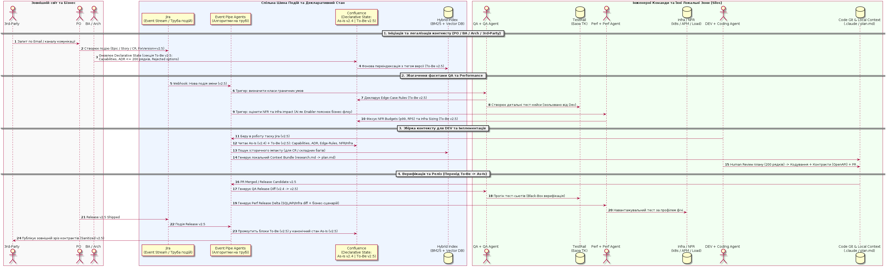
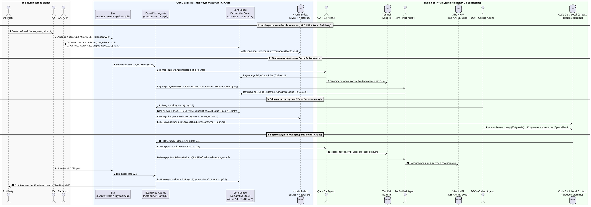
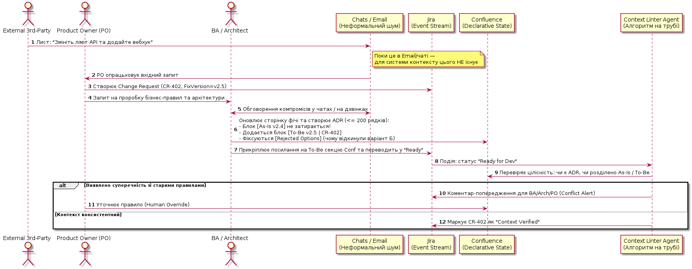
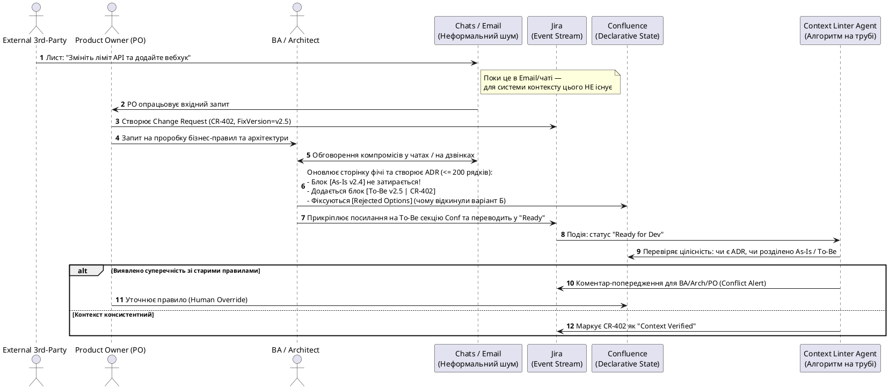
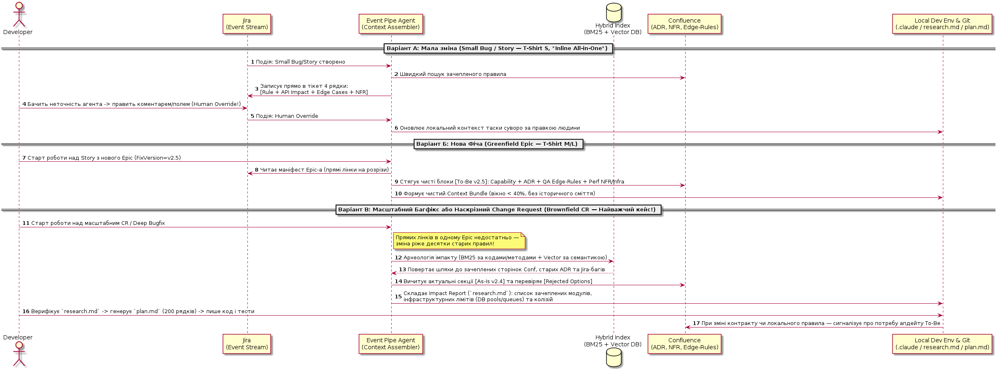
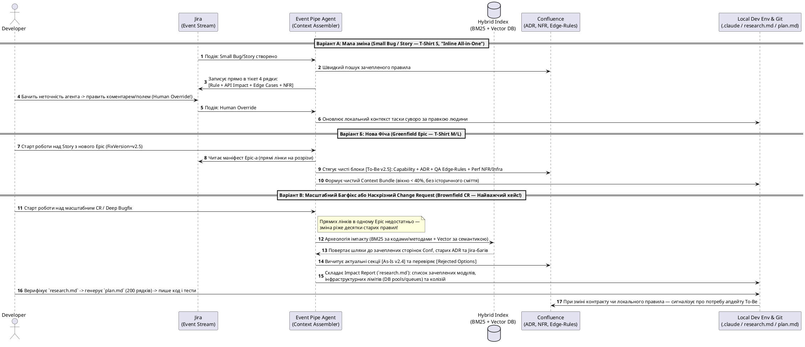
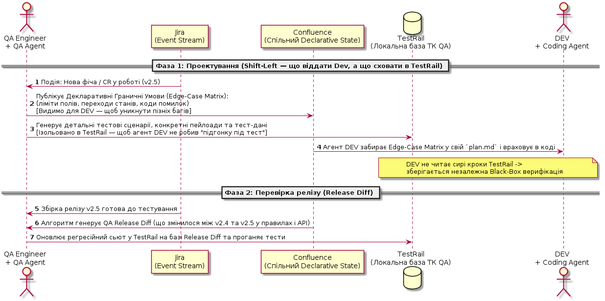
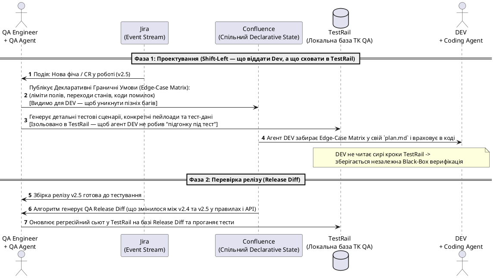
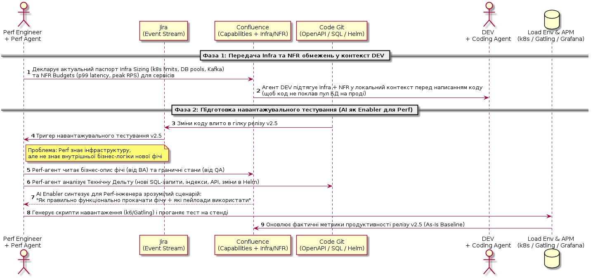
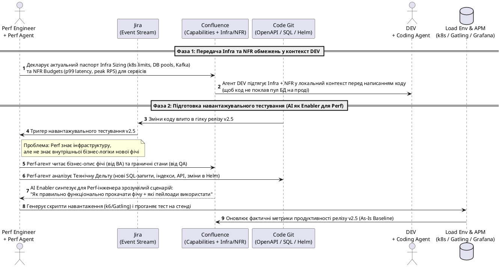

# Інженерний бриф: Архітектура довіреного контексту в AI SDLC та сценарії взаємодії ролей

> 🇺🇦 Українська версія | ⬅️ [Назад до огляду розділу AI SDLC](./index.md) | ➡️ [План науково-практичної статті](./02_context_architecture_plan.md)

**Тема:** Довірений контекст у AI SDLC (`Git + Jira + Confluence + TestRail + Infra/APM`)  
**Критерії проектування:** Прозорість · Простота · Точність

---

## 1. Нативні канали ролей, локальні зони та відповідальні артефакти

Кожна команда працює у своєму нативному інструменті, має власну локальну кухню (яка деталізує реалізацію, але **не повинна суперечити** загальному декларативному стану) і відповідає за свій канонічний артефакт:

| Роль | Нативний канал роботи | Локальний контекст *(Вимога: не суперечити спільній істині)* | Відповідальний артефакт *(Зона володіння)* | Специфіка та парадокси в AI SDLC |
| :--- | :--- | :--- | :--- | :--- |
| **DEV + Coding Agents** | Git, IDE, Jira *(не працюють у Confluence напряму, бо це ненадійний канал без гілкового версіонування)* | Локальна підготовка контексту (`.claude/`, `research.md`, `plan.md`), гілки коду, юніт-тести | Код, OpenAPI/Proto-контракти, схеми БД, Helm/Infra-маніфести, локальні інваріанти сервісу | Збирати контекст легко для нової фічі з нуля, але вкрай важко для **масштабного багфікса чи Change Request (CR)**, де треба підняти історію старих рішень |
| **QA + QA Agents** | База ТК (**TestRail**), Confluence, Jira | Локальні тестові дані, автотести, внутрішні чеклісти QA | Тест-кейси та сьюти у TestRail, матриці станів та **граничні кейси (*edge cases*)** у Confluence/Jira | **Парадокс ізоляції TestRail від Dev:** це і *бага*, і *фіча* залежно від зрілості процесу (див. розд. 3.1) |
| **Perf + Perf Agents** | Confluence, Jira, Інфраструктура (k8s/Grafana/APM) | Скрипти навантаження (JMeter/Gatling/k6), локальні профілі та сирі метрики | Паспорт **Infra Sizing** + **NFR** (SLA, p99, RPS/CPM) у Confluence/Jira | Ізольовано Perf не знає бізнес-логіки нової фічі й як її коректно навантажити. **ШІ стає Enabler-ом**, розмиваючи вузьку спеціалізацію і даючи Perf-у доступ до суті фічі |
| **PO** | Виключно Jira та Confluence | Пріоритизація, клієнтські запити | Епіки/Stories/CR у Jira (`FixVersion`), реєстр бізнес-фіч у Confluence | Єдина точка легалізації зовнішніх вимог у систему інженерного контексту |
| **BA / Arch** | Чати, Email, робочі зустрічі | Чорнові схеми, листування, обговорення компромісів | **Фінальний артефакт — завжди зміна в Confluence/Jira** (бізнес-правила, ADR до 200 рядків, *rejected* варіанти) | **Правило неіснування:** усе, що залишилося в чатах чи пошті і не лягло в Confluence/Jira, для агентів і команд не існує |
| **External 3rd-Party** | Email, зовнішній Confluence/Jira або портал | Зовнішні інтеграційні системи | Запит або узгодження контракту *(якщо прийшло в Email — **обов'язок PO** перенести це в Jira/Confluence)* | Споживають тільки верифікований та очищений (*sanitized*) зовнішній зріз без внутрішньої кухні |
| **AppSec / SRE** *(дод.)* | Сканери, алерти, Jira, Confluence | Логи безпеки та інцидентів, post-mortems | Threat Models / Runbooks під поточний продакшн-реліз | Потребують точного зрізу стану **`As-Is`** на проді без домішок майбутніх чернеток |

---

## 2. Природа інструментів: Jira як Потік Подій vs Confluence як Декларативний Стан

1. **Jira = Event Stream (Труба з подіями змін):**
   - Jira описує не поточний стан системи, а **потік подій (дельт)**: *Story, Bug, Change Request, Epic*.
   - **Архітектурний патерн «Алгоритми на трубі подій»:** на життєвий цикл Jira-подій (створення тікета, зміна статусу, прив'язка `FixVersion`, коментар людини, закриття релізу) підписуються спеціалізовані агентні обробники (пайплайни), які трансформують подію у зміну декларативного стану або збирають контекст під конкретний тип події.
2. **Confluence = Declarative State з явним версіонуванням `As-Is` та `To-Be`:**
   - Щоб Confluence перестав бути «звалищем без версій», вводиться жорстке правило декларації станів: кожна сторінка/секція фіксує поточний стан продакшену (**`As-Is [Release v2.4]`**) та окремо маркований блок цільових змін (**`To-Be [Target v2.5 / Jira-Key]`**), який вливається в основний стан `As-Is` лише після фактичного виходу релізу.
3. **Вимога до локального контексту команд (Consistency Contract):**
   - Кожна команда має право на свої локальні артефакти (Dev у Git, QA у TestRail, Perf у своїх скриптах), але діє жорстке правило: **локальний контекст деталізує реалізацію, проте не може суперечити спільному декларативному стану в Confluence/Jira**.

---

## 3. Чотири глибокі інженерні дилеми (Нюанси реальної практики)

### 3.1. Недоступність TestRail для Dev — це Фіча чи Бага? (Залежність від зрілості)
* **Коли це ФІЧА (Незалежний контур верифікації / Double-Blind Black-Box Guardrail):** якщо Dev або його кодинг-агент бачить точні покрокові тест-кейси та тестові дані з TestRail наперед, виникає ефект *«teaching to the test» (підгонка коду під тест)* — агент пише вузькі `if-else` суворо під відомі сценарії QA, пропускаючи системну доменну логіку. Коли ж QA будує кейси в TestRail незалежно від коду (за спільними бізнес-вимогами), виникає подвійна незалежна перевірка (*Double-Blind Verification*), яка ловить хибні припущення розробника.
* **Коли це БАГА (Пізнє виявлення очевидних граничних умов):** якщо Dev взагалі не знає, які *класи граничних умов* (наприклад, порожні списки, невалідні валюти, ідемпотентні повтори, гонки запитів) QA буде перевіряти, елементарні дефекти спливають занадто пізно і породжують дорогий цикл повернень тікетів.
* **Баланс зрілості:** Dev-у потрібні не сирі тест-кейси з TestRail, а **декларативний перелік граничних умов (Edge-Case Matrix / Rules)** у спільному контексті на вході, тоді як конкретні тестові сценарії та пейлоади в TestRail залишаються незалежною зброєю QA.

### 3.2. Ізоляція Performance-інженерів та ШІ як Enabler (Розмивання меж спеціалізації)
* **Проблема:** Perf-інженер глибоко знає інфраструктуру (k8s, пули БД, профілювання JVM/Go) та NFR, але через вузьку спеціалізацію часто відірваний від внутрішньої бізнес-логіки нових фіч і не знає, *як саме функціонально правильно* зімітувати складний користувацький сценарій.
* **Роль ШІ як Enabler-а:** наявність структурованого контексту фічі (від BA/Dev/QA) дозволяє Perf-інженеру за допомогою AI-агента миттєво зрозуміти бізнес-флоу, згенерувати валідні пейлоади та сценарії навантаження і перетворити свою роботу з «тестування сферичного ендпоінта у вакуумі» на реалістичне тестування бізнес-фічі. Водночас і Dev за допомогою ШІ отримує доступ до експертизи Perf (паспорта Infra Sizing та NFR-бюджетів) ще на етапі планування коду.

### 3.3. Мала зміна vs Масштабна зміна + Керованість людиною (Human Override)
* **Мала зміна (Small Bug / Story — T-Shirt S) — режим «Inline All-in-One» з контролем людини:** агент на трубі Jira автоматично збагачує тікет коротким резюме на 4 рядки (яке правило зачеплено, вплив на API, граничні умови, перевірка NFR), **але людина має простий механізм прямого впливу (Human-in-the-Loop Override)** — інженер/PO/QA може прямо в коментарі чи полі тікета відкоригувати припущення агента («Ні, тут правило X не діє, фіксимо за сценарієм Y»), і агент зобов'язаний перебудувати контекст суворо за цим рішенням людини.
* **Масштабна зміна — розділення за типами задач:**
  - *Нова фіча (Greenfield Feature):* легко розкладається з Jira Epic по чистих нових розрізах у Confluence (Capability, ADR, QA Edges, Perf NFR) і легко збирається у чистий пакет для Dev.
  - *Масштабний багфікс або наскрізний Change Request (Brownfield CR / Deep Refactoring):* **найважчий випадок для збірки контексту Dev-ом!** Бо зміна ріже по живому десятки старих фіч, де історія розмазана по сотнях старих тікетів Jira, ADR та комітів. Саме тут ручний збір контексту гальмує команду, і потрібен спеціалізований алгоритм зворотного збору імпакту (*Impact & History Archeology Agent* на базі гібридного пошуку `BM25 + Vector DB` по Git + Jira + Confluence).

---

## 4. Вибір технологій у цій картині (Фінальна формула)

1. **Людські першоджерела за зонами відповідальності:** `Jira` (труба подій) + `Confluence` (декларативний стан з версіями `As-Is / To-Be`) + `TestRail` (база ТК QA) + `Code Git` (код, контракти, Infra-конфіги).
2. **Алгоритми на трубі подій Jira (Event-Driven Context Agents):**
   - реагують на події в Jira (Нова фіча / Change Request / Масштабний баг / Реліз);
   - перевіряють цілісність контексту (*Context Linter*) та враховують ручні правки людини (*Human Override* у Jira/Confluence);
   - збирають із федеративних джерел верифікований **Context Bundle** у локальне середовище Dev-а (`research.md -> plan.md`) або генерують *Release Delta* (`v2.4 -> v2.5`) для QA і Performance.
3. **Похідний гібридний індекс (`BM25 + Vector DB`) + Процедурна пам'ять (`CLAUDE.md` / `MEMORY.md`):**
   - `BM25 + Vector DB` не замінюють Confluence/Git як першоджерело, а працюють як **пошуковий двигун для складних Change Requests та масштабних багфіксів**, коли агенту треба швидко знайти історичний імпакт по старих тікетах і сторінках із жорсткою фільтрацією за актуальною версією;
   - екстрактивні сервіси (`Mem0`) — тільки для особистих преференцій інженера; графові (`Zep/Graphiti`) — опціонально для трасування складних міжсервісних залежностей при CR.

---

## 5. Сценарії та діаграми послідовності (Sequence Diagrams + PlantUML у згорнутих секціях)

### 5.1. Загальна наскрізна діаграма: Jira Event Pipe → Declarative State (Confluence) → Context Assembly за ролями

<b>Показати вихідний код PlantUML (01_overall_context_flow)</b>

---

### 5.2. Сценарій 1: PO + BA + Arch + 3rd-Party (Перетворення чатів і листів на версіонований Declarative State)

<b>Показати вихідний код PlantUML (02_po_ba_arch_3rdparty_flow)</b>

---

### 5.3. Сценарій 2: DEV + Coding Agent (Три режими: Мала зміна vs Нова фіча vs Масштабний Багфікс / CR)

<b>Показати вихідний код PlantUML (03_dev_three_modes_flow)</b>

---

### 5.4. Сценарій 3: QA (Парадокс TestRail: декларативні граничні умови для Dev vs ізольовані ТК у TestRail)

<b>Показати вихідний код PlantUML (04_qa_testrail_flow)</b>

---

### 5.5. Сценарій 4: Performance Engineer (ШІ як Enabler, що з'єднує бізнес-фічу з Infra + NFR)

<b>Показати вихідний код PlantUML (05_perf_enabler_flow)</b>

