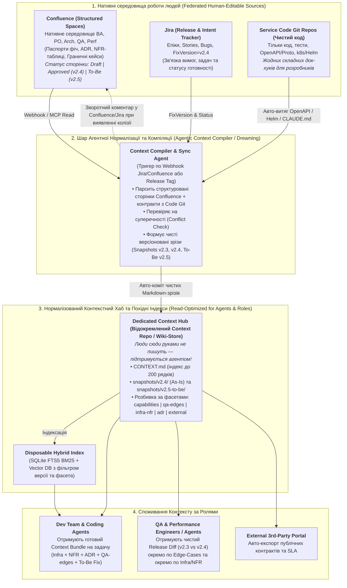

# План науково-практичної статті: Архітектура довіреного контексту в AI SDLC

> 🇺🇦 Українська версія | ⬅️ [Назад до огляду розділу AI SDLC](./index.md) | ⬅️ [Інженерний бриф та діаграми](./01_context_architecture_brief.md)

**Робоча назва:**  
*Архітектура довіреного контексту в AI SDLC: багатовимірна модель знань, версіонування та вибір між канонічним сховищем (Docs-as-Code у Git), семантичними індексами (Vector DB) і сервісами агентної пам'яті (Mem0, Zep, Letta) у контурі Git + Jira/Confluence*

**Зв'язок із попередніми матеріалами циклу:**  
Стаття є прямим розвитком доповіді [Інженерія програмних проєктів з участю ШІ-агентів (19)](../19_ai_sdlc_seminar.md) та операційного брифу [Інженерний бриф та сценарії ролей](./01_context_architecture_brief.md) і присвячена розв'язанню двох фундаментальних проблем управління контекстом у життєвому циклі розробки:  
1. **Multi-Persona Context Gap (Багатопрофільний розрив контексту для споживачів)** — фрагментованість, неповнота та суперечливість контексту для агентів і різних інженерних та бізнес-ролей, де кожній ролі потрібен **принципово різний тип інформації** (для **Performance** — топологія інфраструктури, ліміти ресурсів, профілі навантаження та NFR/SLA; для **QA** — функціональна логіка, матриці станів, негативні сценарії та граничні кейси (*edge cases*); для **BA/PO** — каталог бізнес-фіч і доменні правила; для **Архітекторів** — контракти, межі модулів та ADR; для **External 3rd-parties** — ізольовані публічні API-специфікації та політики сумісності);  
2. **Cross-Cutting Context Assembly & Versioning Drift для самої Dev-команди (Складність збирання цілісного контексту зміни та дрейф станів `As-Is / To-Be`)** — щоб розробник і його кодинг-агент могли коректно реалізувати нову фічу або *to-be* виправлення, їм недостатньо просто відкрити код одного сервісу. Перед написанням коду Dev-команді потрібно **зібрати в єдиний несуперечливий пакет одразу всі перехресні пласти**: цільовий бізнес-намір (*to-be* зміна в Jira), архітектурні рамки й контракти (ADR), інфраструктурні обмеження (Infra: k8s/DB-пули/черги/ліміти), нефункціональні бюджети (NFR: latency/RPS) та граничні кейси валідації. Коли ці знання розпорошені між різними репозиторіями, гілками, тікетами Jira та застарілими сторінками Confluence (де перемішані стани *as-is* та *to-be*), збирання коректного вхідного контексту перетворюється на головну точку відмови для Dev-команди та її агентів.

**Ключові критерії проектування рішення:**  
**Прозорість** (Transparency & Auditability) · **Простота** (Operational Simplicity) · **Точність** (Version & Semantic Precision)

**Базовий стек організації:**  
`Git` (вихідний код та інженерні артефакти) + `Atlassian Jira` (управління задачами, вимогами та релізами) + `Atlassian Confluence` (база знань та крос-командна документація).

---

## 1. Головна теза та дослідницьке питання статті

**Дослідницьке питання:**  
Як побудувати єдину систему управління контекстом для Dev-команди, AI-агентів та всіх суміжних інженерних і бізнес-ролей (QA, Performance, BA, Architects, PO, External 3rd-parties), якій можна довіряти, яку можна версіонувати й синхронізувати між Git та Jira/Confluence? І як правильно розподілити ролі в архітектурній ієрархії між чотирма класами технологій:
1. **Канонічним версіонованим сховищем знань — *Authoritative Store of Record*** (федеративні першоджерела + Git-backed Markdown / Docs-as-Code);
2. **Похідними пошуковими індексами — *Derived Retrieval Indexes*** (лексичними `BM25 / SQLite FTS5` та векторними базами даних `Vector DB`: *pgvector, Qdrant, Chroma, sqlite-vec*);
3. **Сервісами екстрактивної та графової довгострокової пам'яті — *Managed / Extractive Agent Memory*** (*Mem0, Zep / Graphiti, Letta*);
4. **Оперативним контекстом сесії та міжсесійними уроками — *Working Context, Compaction & Procedural Memory***?

**Головна теза (Core Answer):**  
Найбільша помилка сучасних AI-команд — або перетворити пошуковий індекс (*Vector DB*) чи екстрактивний сервіс (*Mem0*) на єдине джерело істини, або ж **примусити нетехнічні ролі (BA, PO, Enterprise Architects, 3rd-party) працювати через Git PR і змішати крос-командну документацію з кодом одного сервісу в одному репозиторії** (що породжує надскладну інфраструктуру хуків, CI-гейтів та конфліктів версіонування).

Для забезпечення **Прозорості, Простоти та Точності** вводиться архітектура **Федеративного Власництва Контексту (Federated Domain-Owned Stores of Record + Agent-Mediated Context Hub)**:
1. **Кожна роль редагує контекст у своєму нативному інструменті (Zero Workflow Friction):** BA, PO, Enterprise/Solution Архітектори та суміжні команди **не працюють з Git напряму** — їхнім простором створення й погодження знань залишаються структуровані шаблони **Confluence та Jira** (з вбудованою історією версій сторінок та статусами), тоді як **Git з кодом** містить лише те, що фізично прив'язане до коду сервісу (OpenAPI/Protobuf контракти з коду, `CLAUDE.md`, локальні модульні тести, Helm/Infra-маніфести).
2. **Відокремлений Контекстний Хаб / Вікі-репозиторій (`Product Context Hub`, оновлюваний агентами, а не людьми вручну):** щоб не змішувати код сервісів із крос-сервісним контекстом (Product Capabilities, NFR, QA Edge-Cases, крос-сервісні ADR) і не будувати складні Git-хуки в кодових репо, нормалізований зріз знань компілюється AI-агентами (*Context Curation / Dreaming Agents*) за подіями з Jira/Confluence та OpenAPI-контрактів сервісів у легкий структурований Markdown-індекс (окремий Context Repo або версіоноване документне сховище).
3. **Пошарова піраміда контексту:**
   `Native Authoritative Sources (Confluence/Jira для BA/Arch/QA/Perf + Code Git для контрактів/Infra) → Agent-Compiled Context Hub (Версіоновані зрізи релізів vX.Y без участі людей у Git) → Derived Hybrid Index (BM25 + Vector DB) + Procedural Agent Memory (Files / Mem0 / Zep) → Curated Working Context (40-60% вікна сесії)`.

---

## 2. Систематизація споживачів контексту та їхніх специфічних інформаційних потреб (Who Needs What Context?)

Ключова теза цього розділу: **«єдиної універсальної документації» не існує**. Те, що є критичним контекстом для Performance-інженера (конфігурація пулів БД, k8s-ліміти та p99 latency), є інформаційним шумом для функціонального QA або BA. Тому в статті детально розмежовуються **10 ролей-споживачів**, де кожна роль потребує власного предметного зрізу контексту:

### 2.1. Базові контури споживачів (за постановкою задачі)
1. **Dev-команда та її ШІ-агенти (Developers, Tech Leads + Coding, Architect, Challenger, TDD Agents):**
   - *Специфічний контекст (Пакет збірки наскрізного контексту для імплементації — Cross-Cutting Assembly):*
     Розробник і кодинг-агент є не лише «постачальниками коду», а **найскладнішими споживачами інтегрованого контексту**. Щоб коректно реалізувати нову вимогу або *to-be* виправлення без архітектурних регресій і падіння продуктивності, Dev-команді необхідно перед початком кодування (на фазах *Research → Plan*) зібрати воєдино 5 розрізнених потоків:
     - **поточний стан коду та модульних інваріантів (*As-Is Code & Hexagonal Ports*):** `CLAUDE.md` / `AGENTS.md`, сигнатури інтерфейсів, схеми БД;
     - **цільову дельту зміни (*To-Be Requirement & Fix Scope*):** що саме має змінитися за тікетом Jira і які граничні кейси (edge cases) мають бути покриті тестами;
     - **архітектурні рішення та контракти (ADR & API Contracts):** у межах яких компромісів та міжсервісних угод дозволено діяти (і які варіанти вже були відхилені — *rejected*);
     - **інфраструктурний контекст середовища (Infra Constraints):** реальні ліміти пам'яті/CPU, розміри пулів з'єднань до БД, топіки черг, таймаути мережі та конфігурації кешування (бо без знання Infra агент напише код, який працює локально на юніт-тесті, але покладе продакшн-пул БД);
     - **нефункціональні бюджети (NFR Budgets):** жорсткі обмеження на p99 latency, алокацію пам'яті, кількість SQL-запитів та пропускну здатність (RPS).
   - *Головний біль Dev-команди:* сьогодні ці 5 шматків лежать у різних світах (код у Git, ADR у старій папці Confluence, NFR у голові перформанс-інженера, Infra у DevOps-репозиторії, а *to-be* правки в коментарях Jira). Ручне збирання цього пазла перед кожним таском забирає левову частку часу розробника, а подача неповного контексту агенту гарантовано веде до переробок (*rework*).
2. **Інженери із забезпечення якості (QA / Functional & Automation Test Engineers та QA-агенти):**
   - *Специфічний контекст (Поведінка, стани та граничні умови):*
     - функціональні вимоги та критерії приймання (Acceptance Criteria / BDD-сценарії);
     - **граничні та кутові кейси (edge & corner cases)**, негативні сценарії, правила валідації полів, ліміти бізнес-значень та очікувані коди/повідомлення помилок;
     - матриці переходів станів (state machines) бізнес-об'єктів та матриця впливу релізу на регресію (які саме користувацькі флоу зачепила зміна в коді).
3. **Інженери з продуктивності та навантажувального тестування (Performance / Load / Capacity Engineers та Perf-агенти):**
   - *Специфічний контекст (Інфраструктура + NFR + Профілі навантаження):*
     - **інфраструктурний зріз (Infra & Sizing):** топологія розгортання, конфігурація кластерів (Kubernetes requests/limits, HPA/autoscaling), налаштування пулів з'єднань (DB connection pools, thread pools), кешів (Redis/TTL), брокерів повідомлень (Kafka partitions/consumers) та зовнішніх інтеграційних вузьких місць;
     - **нефункціональні вимоги (NFR & SLA/SLO):** бюджети затримок (p50, p95, p99 latency), цільова та пікова пропускна здатність (RPS/TPS), допустимий відсоток помилок (error budget);
     - **моделі навантаження та дельта релізу (Workload Models & Release Perf Delta):** реалістичний розподіл трафіку, обсяги даних у таблицях (data cardinality) та точний список того, які саме алгоритми, SQL-запити, індекси чи мережеві виклики змінилися між версіями `vX.Y-1` та `vX.Y`.
4. **Бізнес-аналітики та власники продукту (BA & Product Owners — PO):**
   - *Специфічний контекст (Домен, цінність та життєвий цикл фіч):*
     - актуальний реєстр бізнес-можливостей продукту (Product Capabilities Catalog) людською мовою;
     - доменні правила, бізнес-інваріанти, регуляторні/фінансові обмеження та наскрізні користувацькі сценарії (User Journeys);
     - чітка межа між тим, що вже працює в продакшені (*as-is*), і тим, що проектується на наступні релізи (*to-be* / roadmap).
5. **Архітектори (Software, Solution & Enterprise Architects):**
   - *Специфічний контекст (Структура, контракти та компроміси):*
     - межі доменних контекстів (DDD Bounded Contexts), C4-діаграми, контракти міжсервісної взаємодії та матриця зв'язності (*coupling*);
     - журнал архітектурних рішень (ADR до 200 рядків) із зафіксованими варіантами (*options*), компромісами (*pros & cons*) та явно описаними **відхиленими альтернативами (*rejected options*)**, щоб агенти й команди не поверталися до вже відкинутих рішень.
6. **Зовнішні сторони (External 3rd Parties — партнери, клієнтські інтегратори, вендори, зовнішні аудитори):**
   - *Специфічний контекст (Ізольований контрактний периметр):*
     - суворо очищений від внутрішніх деталей (sanitized), стабільний і версіонований зріз: публічні API-специфікації (OpenAPI / AsyncAPI / GraphQL, webhooks), схеми авторизації (OAuth/mTLS), квоти та rate limits;
     - гарантії SLA, політики виведення старих версій з експлуатації (*deprecation policy*) та гайди з міграції між версіями (*migration guides*).

### 2.2. Додаткові критичні споживачі (за результатами аналізу індустрії: Anthropic, OpenAI, HumanLayer, DORA)
7. **Інженери з безпеки та комплаєнсу (AppSec, InfoSec & Compliance Reviewers):**
   - *Специфічний контекст (OpenAI Compliance Evidence Review, 2026; SAST vs LLM):* моделі загроз (Threat Models), класифікація даних (PII/PCI), поверхня атаки, правила авторизації та доказова трасованість (*provenance*: хто, коли і на підставі якого аудиту погодив архітектурне рішення чи виняток).
8. **Інженери експлуатації та підтримки (SRE, DevOps, Platform & L2/L3 Support):**
   - *Специфічний контекст:* операційний стан **саме того релізу, який зараз у продакшені** — runbooks/playbooks реагування на алерти, активні feature flags, залежності від зовнішніх провайдерів, ліміти конфігурацій та база попередніх інцидентів (post-mortems).
9. **Розробники в ролі верифікаторів (Developers / Tech Leads як Human-in-the-Loop Reviewers):**
   - *Специфічний контекст (HumanLayer, Shift-Left Review):* стислий контекст наміру зміни (200-рядковий Plan / ADR + результати тестів) для швидкої верифікації роботи агента без вичитування 2000 рядків згенерованого коду.
10. **Керівники проєктів та інженерні менеджери (PMO, Delivery Managers, FinOps):**
    - *Специфічний контекст (DORA):* трасованість доставки («Епік у Jira → Специфікація → PR → Реліз»), оцінка ризиків крос-командних залежностей та економіка використання агентів.

---

## 3. Багатовимірна таксономія розрізів контексту (Context Lenses & Dimensions)

Щоб уникнути хаосу, коли одна й та сама сторінка у Confluence змішує старий реліз, майбутню ідею, бізнес-опис і конфігурацію інфраструктури, у статті вводиться **8 ортогональних розрізів (вимірів) контексту**:

| № | Розріз (Вимір) | Категорії всередині розрізу | Яку проблему вирішує |
| :- | :--- | :--- | :--- |
| **1** | **Предметно-фасетний розріз** *(Domain & Role Facet)* | • **Business & Capability Facet** (BA/PO: цінність, флоу, бізнес-правила) • **Behavioral & Edge-Case Facet** (QA: матриці станів, валідації, граничні та негативні кейси) • **Infra, Sizing & NFR Facet** (Performance/SRE: k8s/DB-топологія, ліміти, пули, профілі навантаження, SLA/latency) • **Structural & Contract Facet** (Arch/Dev: порти, ADR, API-схеми) • **Security & External Facet** (AppSec / 3rd-party: загрози, публічний периметр) | Відокремлює принципово різні пласти знань про ту саму систему: QA отримує граничні сценарії та стани без інфраструктурного шуму, а Performance — топологію інфраструктури, ліміти ресурсів і NFR без зайвої води. |
| **2** | **Темпорально-версійний розріз** *(Lifecycle & Version State)* | • **As-Is (Prod / Release `vX.Y`)** — поточна реальність • **In-Flight (Branch / PR / Sprint)** — зміни в роботі • **To-Be (Target / RFC)** — цільовий дизайн • **Superseded / Rejected** — скасовані або відхилені рішення з поясненням *чому* | Усуває *Spec-to-Code Versioning Drift*. Агенти, QA та Performance точно знають, чи вимога/конфігурація вже діє в коді та на стенді, чи лише проектується. Збереження *Rejected* блокує повторну генерацію відкинутих ідей. |
| **3** | **Масштабно-структурний розріз** *(Abstraction Zoom — C4/DDD)* | • **L1: Ecosystem / External** (зовнішні інтеграції) • **L2: Product & Domain** (реєстр фіч, наскрізні флоу та системні NFR) • **L3: Service / Component** (контракти, порти, локальні ADR, sizing сервісу) • **L4: Implementation / Code** (пакети, юніт-тести, лінтери) | Дозволяє подавати кожній ролі та агенту контекст потрібної «висоти польоту» (*Right Altitude* за термінологією Anthropic) без перевантаження вікна. |
| **4** | **Епістемічний розріз** *(Природа знання)* | • **Normative (Інваріанти й закони):** стандарти, контракти, NFR-бюджети • **Descriptive (Стан і факти):** поточна реалізація та топологія • **Procedural (Навички й процеси):** скіли агентів, тест-плани, runbooks • **Episodic (Контекст задачі):** тікет Jira, `research.md`, `plan.md` | Відокремлює непорушні закони системи (які перевіряються гейтами) від тимчасових робочих артефактів конкретної задачі. |
| **5** | **Модальний розріз** *(Форма подання: Людина vs Агент)* | • **Human-Centric View:** візуальні діаграми (Mermaid/PlantUML/C4), таблиці компромісів, оглядові сторінки у Confluence • **Agent-Centric View:** модульний Markdown з YAML-frontmatter, OpenAPI/JSON-схеми, компактні індексні файли (`index.md` до 200 рядків) | Забезпечує подвійну ергономіку: людина не тоне в машинних полотнах, а агент не витрачає токени на парсинг важкої верстки. |
| **6** | **Когнітивний розріз пам'яті** *(за Anthropic та OpenAI)* | • **Working Context:** активне вікно інференсу • **Compaction State:** стиснутий стан поточної довгої задачі • **Long-Term Agentic Memory:** накопичені уроки між сесіями та фонова консолідація (*Dreaming*) | Чітко розмежовує оперативну пам'ять одного прогону, міжфазові артефакти (*FIC*) та довгостроковий досвід агента. |
| **7** | **Розріз довіри та верифікації** *(Trust & Provenance Tier)* | • **Tier 1 — Verified Truth:** пройшло PR-рев'ю людини та CI-лінтери • **Tier 2 — Proposed / Draft:** відкритий RFC або план до затвердження • **Tier 3 — Unverified Agent Note:** сирі спостереження агента | Гарантує, що агент ніколи не сприйме власну неперевірену гіпотезу з попередньої сесії або чорновий коментар у Jira як затверджений закон. |
| **8** | **Розріз контурів доступу** *(Security & Boundary Scope)* | • **Internal Engineering** (повний доступ до коду, інфраструктури й ADR) • **Cross-Functional Internal** (продукт, QA, Performance, BA) • **External 3rd-Party** (експортований публічний периметр) | Дозволяє генерувати для 3rd-party партнерів гарантовано точну документацію з того самого джерела істини, відфільтровуючи внутрішні деталі за тегами. |

---

## 4. Класифікація архітектурних шарів пам'яті та аналіз світових підходів (HumanLayer, Anthropic, OpenAI, Letta)

Цей розділ статті замінює хаотичне змішування термінів строгою інженерною класифікацією: **який саме клас сховищ за що відповідає у контурі контексту?**

### 4.1. Принципове розмежування 4 класів систем у піраміді контексту
Щоб побудувати прозору і точну архітектуру, необхідно розвести по різних рівнях чотири категорії технологій, які в індустрії часто помилково ставлять через «або»:
1. **Federated Authoritative Sources & Compiled Context Hub (Федеративні першоджерела за доменами + Агентно-компільований хаб контексту):**
   - *Нативні людські першоджерела:* структуровані простори **Confluence** (де BA, PO, Архітектори, QA та Performance ведуть фічі, ADR, граничні кейси та NFR-таблиці без необхідності знати Git), **Jira** (релізний скоуп `FixVersion` та задачі) та **Service Code Git** (де розробники тримають виключно код, OpenAPI/Proto-контракти й Helm/Infra-маніфести без обтяжливих документаційних хуків).
   - *Нормалізований Context Hub (Compiled Markdown Snapshot Store):* відокремлене від кодових репо сховище чистих версіонованих Markdown-зрізів (`v2.4-as-is`, `v2.5-to-be`), яке автоматично збирається та валідується фоновим агентом-компілятором (*Anthropic Dreaming pattern*) із Confluence, Jira та Code Git.
2. **Derived Retrieval Index (Похідний пошуковий індекс — *Lexical BM25 / SQLite FTS5* та *Semantic Vector DB: pgvector, Qdrant, Chroma, sqlite-vec*):** допоміжна пошукова структура даних, побудована поверх нормалізованого Context Hub та історичних архівів (Jira/Confluence) для швидкого точного або семантичного пошуку. Якщо видалити індекс, жодне знання не втрачається — він перезбирається з першоджерел однією командою.
3. **Extractive & Graph Agent Memory Layer (Сервіси автоматичної екстрактивної та темпорально-графової пам'яті — *Mem0, Zep / Graphiti*):** спеціалізований проміжний шар, де LLM автоматично витягує атомарні факти, преференції користувачів або часові зв'язки сутностей із потоку діалогів і зберігає їх за API.
4. **Procedural Session & Long-Term Agentic Memory (Оперативний стан сесії та процедурна пам'ять воркфлоу — *FIC Artifacts, CLAUDE.md / MEMORY.md, Letta MemFS, Anthropic Dreaming*):** механізми утримання робочої пам'яті активного прогону (*Compaction*) та збереження міжсесійних правил і виправлених помилок самого агента.

### 4.2. Чому семантичні індекси (*Vector DB*) та екстрактивні сервіси пам'яті (*Mem0*) НЕ підходять як первинне джерело контексту (*Store of Record*) у SDLC
Порівняльний аналіз показує 5 фундаментальних обмежень використання векторних баз і систем автоматичної екстракції фактів (класу *Mem0*) як канонічного сховища інженерного контексту:
1. **Втрата версійності та часової точності:** косинусна близькість ембеддингів вимірює тематичну схожість, а не актуальність. Векторний пошук з однаково високим рейтингом повертає і чинну вимогу `v2.4`, і скасовану вимогу `v1.9`, і чернетку `v3.0`, змішуючи їх у контексті агента.
2. **Деградація логіки при чанкінгу (Chunking Problem):** розбиття таблиці NFR, архітектурного контракту чи ADR на фрагменти по 300-500 токенів відриває умови застосування правила від самого правила.
3. **Слабкість на точних інженерних ідентифікаторах:** інженери та кодинг-агенти шукають точні назви методів, коди помилок (`ERR_AUTH_TIMEOUT`), ключі Jira, імена сервісів та SLA-метрики. Векторний пошук програє тут звичайному `grep` або BM25.
4. **Непрозорість (Black Box) та відсутність PR-рев'ю:** неможливо зробити осмислений `git diff` для векторів у базі даних або прихованих записів за API Mem0, коли потрібно атомарно зарев'ювати зміну коду разом зі зміною документації.
5. **Ризик накопичення хибних фактів при авто-екстракції (Mem0):** у Mem0 мовна модель сама витягує «факти» з діалогів. У призначених для кінцевих користувачів B2C-чатах це чудово працює для запам'ятовування вподобань користувача, але в SDLC випадкова репліка розробника під час обговорення гіпотези може записатися в пам'ять як «архітектурний факт».

### 4.3. Синтез передових практик лідерів індустрії (2025-2026 рр.)
У статті наводяться чотири ключові підходи з першоджерел:
- **Anthropic (*Effective Context Engineering*, вер. 2025; *The Components of Agent Memory*, лист. 2026):**
  - *Just-in-Time Retrieval & Progressive Disclosure:* замість попереднього завантаження великих масивів через RAG на старті сесії в контекст завантажується лише компактний індекс-мапа (`CLAUDE.md` / `MEMORY.md` до 200 рядків або 25 КБ), а деталізовані файли підтягуються агентом на вимогу через файлові інструменти (`glob`, `grep`, `read`).
  - *Файлова пам'ять і концепція «Dreaming» (фонової консолідації):* агент зберігає досвід у структурованих файлах, але оскільки нотатки, зроблені «в моменті», можуть містити помилки або застарівати, вводиться фоновий процес *dreaming* (перевірка нотаток відносно сирих транскриптів/фактів, виправлення суперечностей, злиття дублікатів та побудова зв'язаної Markdown-Wiki з крос-посиланнями).
  - *Ізоляція одного джерела на один контракт:* експерименти Anthropic показали, що коли кілька агентів пишуть у спільну зведену таблицю, втрачається до 28% фактів через перезапис; коли кожен контракт зберігається в окремому модульному файлі з точними цитатами, точність досягає 100%.
- **HumanLayer (D. Horthy, *Advanced Context Engineering*, 2025; S. Grove, *Specs are the new code*):**
  - Специфікації та плани — це новий вихідний код. Короткоживучі контекстні артефакти фаз `research.md → plan.md` дозволяють утримувати заповнення вікна в межах 40-60% і стають точкою високорівневого контролю людиною.
- **OpenAI (*Agents SDK: Building Reliable Agents with Memory and Compaction*, 2026):**
  - Строгий поділ відповідальності: **Compaction** стискає робочий стан активної сесії; **Agent Memory** зберігає у файлах лише *процедурні уроки та преференції воркфлоу* (і трактується агентом виключно як підказка, яка ніколи не переважає над поточним станом середовища); а **Reviewed Artifact (Memo / Spec)** залишається єдиним верифікованим людиною джерелом істини щодо предметної області.
- **Letta / ex-MemGPT (реліз *Letta Code / MemFS*, лютий 2026):**
  - Показовий індустріальний прецедент: команда, яка створила один із найвідоміших серверів агентної пам'яті, у 2026 році перевела архітектуру пам'яті кодинг-агентів на **Markdown-файли з YAML-frontmatter всередині Git-репозиторію**, бо тільки це дає прозорість, портируваність і контроль версій.

### 4.4. Підсумкова матриця вибору за класами технологій для статті

| Клас технології (та типові представники) | Архітектурна роль у SDLC | Де дає максимальний виграш | Чому не може бути єдиним рішенням |
| :--- | :--- | :--- | :--- |
| **1. Версіоноване файлове сховище специфікацій** *(Git + Markdown з YAML-frontmatter, Docs-as-Code, Letta MemFS)* | **Primary Store of Record** (канонічне джерело істини для архітектури, фіч, Infra/NFR, граничних кейсів QA, ADR, контрактів) | 100% прозорість, атомарне версіонування з кодом у PR, `git blame/diff`, читабельність для людей і LLM | При масштабуванні понад тисячі файлів або нечіткому формулюванні запиту звичайний `grep` пропускає синоніми |
| **2. Похідний лексичний індекс** *(Full-Text Search / BM25: SQLite FTS5, Tantivy, Lucene)* | **Derived Index №1** (швидкий точний та лексичний пошук поверх Git-файлів) | Миттєвий пошук точних термінів, кодів помилок, назв сервісів, конфігурацій і ключів Jira; нульова вартість інфраструктури | Не знаходить документи, де проблема описана іншими словами без збігу термінів |
| **3. Похідний семантичний індекс** *(Vector DB / Embeddings: pgvector, sqlite-vec, Qdrant, Chroma)* | **Derived Index №2** (семантичний пошук у гібридній зв'язці `BM25 + Vector DB` через *Reciprocal Rank Fusion*) | Пошук за змістом у великих неструктурованих архівах (тисячі історичних тікетів Jira, інцидентів, старих сторінок Confluence) | Сліпий до версій релізів і статусів (`active` vs `rejected`) без жорсткої фільтрації за метаданими файлу-джерела |
| **4. Екстрактивна персоналізована пам'ять діалогів** *(Extractive Memory Layer: Mem0, нативна пам'ять чат-асистентів)* | **Опціональний шар персоналізації** (індивідуальні преференції конкретного інженера чи користувача між сесіями) | Автоматичне запам'ятовування звичок окремого користувача в B2C/SaaS без ручного ведення нотаток | Непридатний для канонічних командних специфікацій SDLC через непрозору LLM-екстракцію та відсутність Git-версіонування |
| **5. Темпорально-графова пам'яті сутностей** *(Temporal Knowledge Graph: Zep, Graphiti, MCP Graph Servers)* | **Спеціалізований графовий шар** (складна історія зміни зв'язків між сутностями в часі) | Bi-temporal запити («який контракт чи топологія діяли в березні») та обхід графу міжсервісних залежностей | Висока складність інфраструктури; у більшості інженерних команд замінюється явною структурою YAML-посилань у Git + історією комітів |

---

## 5. Цільова прикладна архітектура: Федеративний контекст без примусу не-розробників до Git і без змішування коду з документацією

У цьому розділі статті розв'язується головне практичне протиріччя класичного підходу *Docs-as-Code*:
1. **Чому BA, PO, Архітектори та External 3rd-party НЕ повинні (і не будуть) писати в Git:** вимагати від бізнес-аналітика чи зовнішнього партнера створювати гілки та Pull Request-и в Git — це організаційна утопія, яка ламає критерій **Простоти**.
2. **Чому тримати продуктовий/крос-командний контекст в одному Git-репозиторії з кодом сервісу — це антипатерн:** змішування коду та документації в одному репо вимагає складних pre-commit/CI хуків, блокує коміти розробників через правки текстів, створює плутанину у версіонуванні (коли документація описує продукт із 15 мікросервісів або стан *to-be* наступного кварталу, а гілка коду належить одному мікросервісу версії *as-is*).

### 5.1. Принцип «Федеративне власництво + Агент-Компілятор Контексту» (Federated Sources + Agent-Compiled Context Hub)
Замість змушувати людей працювати в чужих для них інструментах або змішувати все в моно-репо коду, обов'язки розділяються на **4 взаємопов'язані контури**:

### 5.2. Як працює ця архітектура на практиці (Простота для людей + Точність для агентів)

1. **Повна відсутність Git-тертя для BA, PO, Архітекторів, QA та Performance:**
   - **BA/PO** ведуть реєстр фіч і бізнес-правила у **Confluence**, використовуючи прості стандартизовані таблиці/властивості сторінки (*Page Properties*: `Target Release: v2.5`, `Status: To-Be / Active`, `Jira Epic`).
   - **Архітектори** пишуть та погоджують ADR (до 200 рядків) прямо у **Confluence** (де зручно коментувати бізнесу і суміжним командам).
   - **QA та Performance** ведуть матриці граничних сценаріїв та таблиці NFR/SLA у своїх профільних розділах **Confluence / Jira**, не торкаючись Git.
2. **Чисті кодові репозиторії (Code Git без зайвих хуків):**
   - У Git-репозиторії сервісу живе **тільки те, що є кодом**: вихідний код, тести, локальний `CLAUDE.md` (правила модуля), автогенеровані або декларативні схеми інтерфейсів (`openapi.yaml`, `schema.graphql`, `.proto`) та інфраструктурні конфіги (`values.yaml` / Terraform). Ніяких блокуючих хуків на бізнес-документацію в кодовому репо немає.
3. **Як з'являється версіонований машиночитаний контекст — виділений `Context Hub` під керуванням Агента-Компілятора:**
   - Між людським Confluence/Jira та кодовими репозиторіями стоїть фоновий **Context Compiler Agent** (практична реалізація концепції *Anthropic Dreaming / Offline Consolidation*).
   - Коли в Confluence сторінка отримує статус `Approved` або в Jira формується скоуп релізу `FixVersion = v2.4`, агент-компілятор витягує структурований зміст із Confluence/Jira, поєднує його з фактичними OpenAPI-контрактами й лімітами з `values.yaml` кодового репозиторію і записує нормалізовані компактні Markdown-файли з YAML-метаданими у **відокремлений `Context Hub`** (окремий легкий репозиторій знань або версіоноване сховище, куди люди руками не ходять).
   - **Автоматична детекція суперечностей:** якщо в Confluence записано NFR `timeout: 2s` і DB pool `50`, а в Helm-чарті кодового репозиторію стоїть `timeout: 30s` і pool `10`, агент-компілятор підсвічує цю розбіжність коментарем у Jira/Confluence ще до релізу.
4. **Як Dev-команда за секунди збирає контекст на задачу (Context Assembly Bundle):**
   - Розробнику більше не треба шукати по Confluence і чатах. Його кодинг-агент підключається до `Context Hub` (як read-only MCP або підмодуль/пакет знань) і за номером Jira-тікета отримує вже зібраний та очищений від шуму **Context Bundle**: (а) *to-be* вимога з Jira/Confluence, (б) пов'язаний ADR, (в) поточні Infra-ліміти та NFR-бюджети сервісу, (г) граничні кейси від QA.
5. **Як вирішується проблема `As-Is` vs `To-Be` без гілкування коду:**
   - У Confluence та Jira кожна зміна маркується цільовим релізом (`FixVersion: v2.4` — поточний прод *as-is*, `FixVersion: v2.5` — в розробці *to-be*).
   - `Context Hub` зберігає ці зрізи окремо (`snapshots/v2.4-prod/` та `snapshots/v2.5-to-be/`). Завдяки цьому:
     - **Support / SRE / Performance на проді** читають зріз `v2.4-prod` (*as-is*);
     - **Dev-команда**, яка пиляє фічу на `v2.5`, читає зріз `v2.5-to-be` разом із базою `v2.4`;
     - **QA та Performance** перед виходом `v2.5` отримують автоматично згенерований звіт-диф `Release Delta (v2.4 → v2.5)` окремо по функціональних граничних кейсах і окремо по змінах в Infra/NFR.
6. **Для External 3rd Parties:**
   - Із цього ж `Context Hub` за тегом `audience: external` автоматично публікується зовнішній портал документації чи клієнтський Confluence-спейс/OpenAPI-каталог без ручного копіювання і без жодного доступу 3rd-party до внутрішнього Git.

---

## 6. Структура та обсяг майбутньої основної статті

Стаття проектується у форматі ґрунтовної інженерно-наукової публікації (орієнтовно 7 розділів):

1. **Вступ. Криза довіри до контексту в AI SDLC:** чому зі зростанням ролі агентів головним вузьким місцем стає не генерація коду, а розсинхронізована та неструктурована документація між командами.
2. **Анатомія споживачів контексту (10 ролей та їхні різні інформаційні світи):** чому універсальної документації не існує — детальне розмежування потреб Кодинг-агентів, Функціонального QA (стани, негативні сценарії та граничні кейси *edge cases*), Performance-інженерів (інфраструктурний sizing, топологія, пули БД, профілі навантаження та NFR/SLA), BA/PO, Архітекторів, AppSec, SRE та зовнішніх 3rd-party інтеграторів.
3. **Восьмивимірна модель розрізів контексту:** формалізація предметно-фасетного, темпорального (*as-is / in-flight / to-be / rejected*), масштабного (L1-L4), епістемічного, модального, когнітивного та безпекового розрізів.
4. **Архітектурна таксономія пам'яті та індексів: канонічне сховище проти похідних індексів і екстрактивної пам'яті.** Глибокий розбір ієрархії *Authoritative Store of Record (Git Markdown) → Derived Retrieval Indexes (BM25, Vector DB) → Extractive/Graph Agent Memory (Mem0, Zep) → Procedural Session Memory* на базі досліджень Anthropic (2025-2026), OpenAI (2026), HumanLayer та Letta.
5. **Референсна федеративна архітектура (Confluence/Jira + Чистий Code Git + Виділений Agent-Compiled Context Hub):** як забезпечити роботу BA/Arch/QA/Perf у рідному Confluence/Jira без Git, не захаращувати кодові репозиторії складними хуками і водночас автоматично компілювати версіоновані зрізи (`vX.Y-as-is` та `to-be`) для Dev-команди, агентів та 3rd-party.
6. **Практичні патерни роботи для різних команд:** конкретні сценарії для QA (генерація тестів по матриці граничних умов та *QA Release Diff*), Performance (аналіз *Infra + NFR + Perf Release Delta*), BA/Arch (цикл ADR на 200 рядків) та 3rd-party (деталізовані послідовні схеми наведено в [Інженерному брифі](./01_context_architecture_brief.md)).
7. **Висновки та дорожня карта впровадження:** покроковий перехід від хаотичної Wiki до довіреної архітектури контексту за критеріями прозорості, простоти й точності.

---

## 7. Ключові джерела для бібліографії статті

1. **Anthropic Applied AI (Sept 2025):** *Effective context engineering for AI agents* — концепції уваги як вичерпного бюджету, *Just-in-Time Retrieval*, *Progressive Disclosure*, гібридної навігації (`CLAUDE.md` + `glob/grep`) та субагентної ізоляції.
2. **Anthropic Research (Nov 2026, L. Martin et al.):** *The components of agent memory* — розмежування *compaction* та *agent memory*, проблема надмірного запису пам'яті, механізм фонової консолідації та самокорекції пам'яті (*Dreaming*), побудова агентних Wiki та правило ізоляції окремих сторінок під кожен контракт.
3. **HumanLayer (D. Horthy, Aug 2025; S. Grove, 2025):** *Advanced Context Engineering for Coding Agents* та *Specs are the new code* — утримання контексту в зоні 40-60%, *Frequent Intentional Compaction (Research → Plan → Implement)* та специфікації як первинний артефакт розробки.
4. **OpenAI (2026):** *Building Reliable Agents with Memory and Compaction (OpenAI Agents SDK)* — архітектурний поділ між *Compaction* (робочий стан сесії), *Memory* (повторно використовувані процедурні уроки у файлах) та *Human-Reviewed Artifact* (канонічне джерело істини з трасованістю доказів *provenance*).
5. **Індустріальні порівняння архітектур пам'яті (2026):** перехід *Letta Code (ex-MemGPT)* на Git-backed Markdown (*MemFS*, лютий 2026); порівняльний аналіз *Markdown Files vs. SQLite FTS5 (BM25) vs. Vector DB vs. Mem0 / Zep (Graphiti)* та патерн *File Store of Record + Disposable Hybrid Index (Reciprocal Rank Fusion)*.
6. **Architecture as Truth & Docs-as-Code у AI SDLC (2025-2026):** практики синхронізації Git ↔ Confluence та версіонування архітектурних і продуктових контрактів атомарно з релізним циклом.
